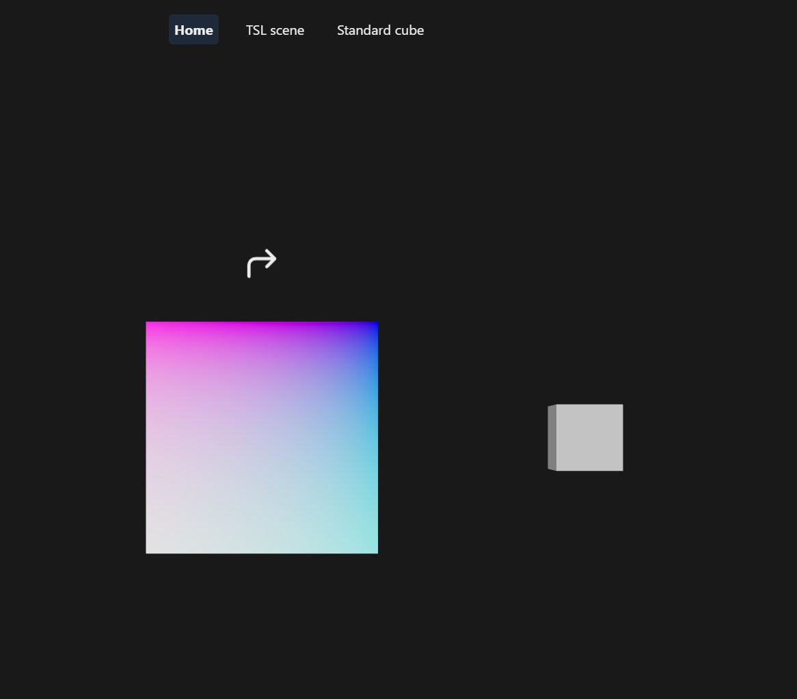

# Next.js WebGPU starter

A Simple Next.js App Router starter for React Three Fiber v10 alpha, Drei alpha, and Three.js Shading Language (TSL). It includes interactive scene navigation, React Spring animations, and live material controls in the Three.js Inspector. All scenes use `WebGPURenderer`, with Three.js's WebGL2 fallback for browsers without WebGPU.



## Demo
Check the [Demo](https://kemdev.github.io/nextjs_r3f_drei_alpha_turbo/) online.

## Getting Started
Use Node.js 20.9 or later and Bun 1.4.2.

```sh
bun install
bun run dev
```

<details>
<summary>NPM</summary>

```sh
 npm i
 npm run dev
```

</details>


| Route | Example |
| --- | --- |
| `/` | Interactive overview with the TSL plane and cube on one canvas |
| `/tsl` | TSL gradient with a live blue-channel slider in the Inspector |
| `/cube` | Lit cube with a live material color picker in the Inspector |

## Explore the scenes

- Hover over either object to see it grow and reveal a Lucide icon rendered through Drei's `Html`. The cube blends toward purple and the plane blends toward an inverted gradient. React Spring animates the scale, the icon, and the uniform that drives each color transition.
- Click an object on the overview to open its scene. Click the object on a detail page to return home. The hover icon indicates the destination. The navbar supports keyboard navigation and identifies the current route.
- With reduced motion enabled, the hover feedback appears immediately and the objects keep their original scale.
- Drag the canvas to orbit and scroll to zoom. On either detail page, open the Inspector and select **Parameters**. Use **TSL scene → Gradient → Blue channel** or **Cube → Material → Color** to edit the material live.

## Project structure

```
┣ 📂public                       Static assets such as models and textures
 ┣ 📂src                       
 ┃ ┣ 📂app                       Route entry points and root layout
 ┃ ┣ 📂components                Shared Canvas, orbit controls, and Inspector
 ┃ ┃ ┣ 📂three                       
 ┃ ┃ ┗ 📂ui                      Drei Html wrapper for the scene navigation icons
 ┃ ┣ 📂features                       
 ┃ ┃ ┗ 📂scenes                       
 ┃ ┃ ┃ ┣ 📂cube                  Cube material, interaction, and detail view    
 ┃ ┃ ┃ ┣ 📂overview              Home scene and object destinations         
 ┃ ┃ ┃ ┗ 📂tsl                   TSL shader, interaction, and detail view    
 ┃ ┣ 📂lib                       
 ┃ ┣ 📂styles                    Tailwind CSS entry point and canvas layout   
 ┃ ┗ 📂ui                        Navbar and active route styling
```

Start with `src/features/scenes/overview/OverviewView.tsx` to change the home scene. Each scene contains its material, hover animation, icon, and navigation. The detail views provide their cameras and Inspector uniforms.

To add a route, create a client view under `src/features/scenes/`, render it from a page in `src/app/`, and add its link to `src/ui/Navbar.tsx`. The two detail views use `next/dynamic` with `ssr: false` to load their scenes in the browser. The overview composes both scenes and supplies their destinations.

## Inspector and Fast Refresh

`SceneInspector` attaches the native Three.js Inspector. Drei 11.0.0-alpha.7's Inspector wrapper calls an API removed in Three.js r187.

> [!WARNING] ⚠️
> Drei Inspector produce an error, and must be updated to Drei later when the library is updated.

Each detail view shares its material uniform with the Inspector. `SceneCanvas` binds OrbitControls to the canvas element so the Inspector can receive clicks.

Material keys and the Inspector effect let material instances and Inspector bindings refresh when their inputs change. `OverviewView` shows how to use `SceneCanvas` without an Inspector.

The navbar uses Next.js `Link` and mesh clicks use `router.push`, enabling client-side navigation.

> [!NOTE] 💡
> If Fast Refresh stops updating after navigation during development, reload the destination page once. Turbopack issue #98699

## Check and serve a production build

```sh
bun run typecheck
bun run build
bun run start
```

`dev` and `build` use Turbopack. Keep `bun.lock` with the project so a fresh fork or download installs the same dependency versions.

With the locked versions, the build can emit an `addEffect` deprecation warning from React Spring's R3F adapter. The production build still completes.

## Browser tests and CI

```sh
bunx playwright install chromium
bun run test:e2e
```

Locally, Playwright starts the development server on port 3000 or reuses the running starter on that port. CI starts its own server on port 3100. The suite covers keyboard navigation, reduced-motion hover icons, mesh navigation, both Inspector controls, and a real Fast Refresh edit on a directly loaded route. The Fast Refresh test temporarily edits and restores the cube view. The suite uses software WebGL2 so it can run on machines without a GPU.

GitHub Actions runs the frozen install, type check, production build, and browser suite on pull requests and pushes to `main`.i